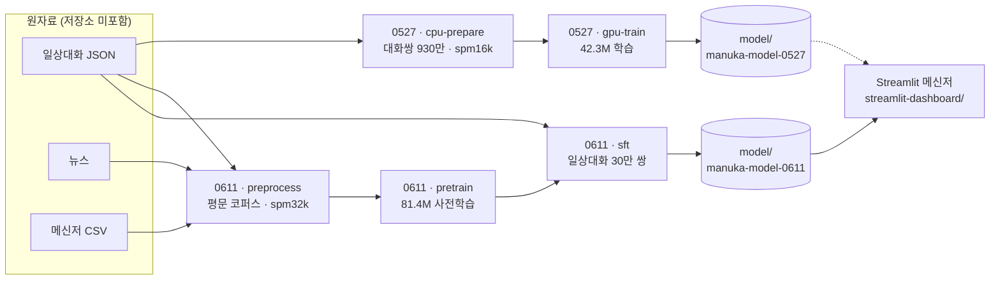

<a id="readme-top"></a>

<div align="center">

# Manuka Chat

**작은 GPT를 처음부터 직접 만들어, 한국어로 일상 대화를 나눌 수 있을까?**

한국어 일상대화·뉴스·메신저 말뭉치로 SentencePiece 토크나이저와 GPT형 Transformer를 학습하고,<br>
그 체크포인트와 대화하는 **Streamlit 메신저 데모**까지 만든 프로젝트. 모델은 외부 모델 라이브러리 없이 **PyTorch로 직접 구현**했다.

<sub>체크포인트 2종 (0527 · 0611) · 42.3M / 81.4M 파라미터 · Google Colab 학습 · 단일 턴 한국어 대화</sub>

<br>

[](.devcontainer/devcontainer.json)
[](requirements.txt)
[](requirements.txt)
[](streamlit-dashboard/)
[](notebook/)
[](.gitattributes)

[데모 실행](#시작하기) · [학습 과정](#학습-파이프라인) · [결과 보기](#학습-결과) · [폴더 안내](#저장소-구성)

</div>

<br>

> [!NOTE]
> **지금 상태** — 데모 기본 모델은 `manuka-model-0611`(81.4M)이다. 뉴스·일상대화 텍스트로 사전학습한 뒤 일상대화 30만 쌍으로 SFT했다. **직전 발화 하나를 보고 다음 발화 하나를 만드는 단일 턴 모델**이라 앞선 대화를 기억하지 않는다. 구어체 문장은 만들어 내지만, 답이 질문의 맥락에서 금방 벗어나는 경우가 많다. 자세한 내용은 [학습 결과](#학습-결과)와 [한계와 알려진 문제](#한계와-알려진-문제)에 있다.

<details>
<summary><b>목차</b></summary>

1. [한눈에 보기](#한눈에-보기)
2. [프로젝트 소개](#프로젝트-소개)
3. [데이터](#데이터)
4. [학습 파이프라인](#학습-파이프라인)
5. [학습 결과](#학습-결과)
6. [채팅 데모](#채팅-데모)
7. [저장소 구성](#저장소-구성)
8. [시작하기](#시작하기)
9. [구현 원칙](#구현-원칙)
10. [한계와 알려진 문제](#한계와-알려진-문제)
11. [진행 기록](#진행-기록)
12. [참고자료](#참고자료)

</details>

---

## 한눈에 보기

| 구분 | 내용 |
|---|---|
| **무엇** | 처음부터 학습한 소형 한국어 대화 모델 Manuka와 Streamlit 채팅 데모 |
| **모델** | 디코더 전용 Transformer — RoPE · RMSNorm · QK-Norm · SwiGLU · 임베딩–출력층 가중치 공유, PyTorch로 직접 구현 |
| **체크포인트** | `manuka-model-0527` 42.3M · 어휘 16k / `manuka-model-0611` 81.4M · 어휘 32k (데모 기본값) |
| **토크나이저** | SentencePiece Unigram, byte fallback, 특수 토큰 `PAD` `BOS` `SEP` `EOS` `UNK` = 0 1 2 3 4 |
| **데이터** | 일상대화 JSON 14,229개 · 뉴스 문서 1,206,618개 · 메신저 대화 3,836개 (원자료는 저장소에 없음) |
| **학습 방식** | 0527: 대화쌍 지도학습 / 0611: 평문 사전학습 → 일상대화 SFT |
| **학습 환경** | Google Colab + Google Drive, Jupyter Notebook 9개 |
| **데모** | Streamlit 메신저 UI — CPU·GPU 자동 선택, 샘플링 설정 조절, 모델 파일 상태 점검 |
| **상태** | 체크포인트 2종 학습 완료, 데모 동작 확인. 검증 손실 외의 정량 평가는 없음 |

<p align="right"><a href="#readme-top">맨 위로 ↑</a></p>

---

## 프로젝트 소개

### 무엇을 만들었나

대형 언어 모델을 이루는 부품 — 토크나이저, Transformer, 사전학습, 지도 미세조정(SFT), 샘플링 디코딩 — 을 직접 구현해, 한국어로 말을 주고받는 작은 모델 하나를 처음부터 끝까지 만들었다.

모델 코드는 Hugging Face 같은 외부 모델 라이브러리를 쓰지 않고 PyTorch 기본 연산으로 작성했다. 학습 노트북과 추론 모듈([`manuka_inference.py`](streamlit-dashboard/manuka_inference.py))이 같은 `GPTScratch` 구조를 공유하므로, 노트북에서 저장한 `model.pt`를 데모 앱이 그대로 읽는다.

모델이 하는 일은 단순하다. 사용자의 발화 하나를 받아 **그 뒤에 올 법한 발화 하나**를 만든다. 학습 데이터도 같은 모양 — 한국어 일상 대화에서 앞 발화와 뒤 발화를 짝지은 쌍 — 으로 만들었다.

### 두 번의 실험

| 버전 | 학습 방식 | 학습 데이터 | 모델 | 결과 |
|---|---|---|---|---|
| **0527** | 대화쌍 지도학습 한 단계 | 일상대화 쌍 9,298,863개 | 42.3M · 10층 · 어휘 16k | 5 epoch, 검증 손실 4.280 |
| **0611** | ① 평문 사전학습 → ② SFT | ① 뉴스·일상대화 청크 1,599,292개 (5.5억 토큰)<br>② 고품질 일상대화 쌍 300,000개 | 81.4M · 12층 · 어휘 32k | SFT 1 epoch, 검증 손실 3.931 |

폴더와 노트북 이름의 숫자는 실험 날짜(MMDD)다. 0611에서는 모델을 키우고, 대화 형식을 가르치기 전에 뉴스·일상대화 평문으로 다음 토큰 예측부터 익히는 2단계 방식으로 바꿨다. 두 손실값은 토크나이저와 데이터가 달라 직접 비교할 수 없다([학습 결과](#학습-결과) 참고).

<p align="right"><a href="#readme-top">맨 위로 ↑</a></p>

---

## 데이터

> [!IMPORTANT]
> **원자료는 저장소에 포함되어 있지 않다.** 노트북은 Google Drive의 `MyDrive/text_dataset/dataset/` 아래에 아래 zip 파일이 있다고 가정한다. 저장소에는 일상대화 원자료의 형식을 보여 주는 샘플 1건([`example.json`](example.json))만 있다.

### 원자료

| 자료 | 파일 | 형식 | 규모 | 쓰인 곳 |
|---|---|---|---|---|
| 일상대화 | `일상대화_데이터.zip` | JSON (`document` → `utterance`), [`example.json`](example.json)과 같은 형식 | 파일 14,229개 · 발화 4,570,823개 | 0527 학습 쌍, 0611 사전학습·SFT |
| 뉴스 | `뉴스_데이터.zip` | JSON · JSONL · TXT (본문 필드를 자동으로 찾음) | 문서 1,206,618개 | 0611 사전학습 |
| 메신저 | `메신저_데이터.zip` | CSV (`doc_id`, `form`, `speaker` 열) | 대화 3,836개 | 0611 토크나이저 학습. SFT용 쌍 660,455개도 만들었지만 최종 모델 학습에는 쓰지 않음 |

일상대화 문서는 2인 대화가 11,520개로 가장 많고, 1인 380개, 3인 1,554개, 4인 775개다.

### 일상대화 원자료 형식

[`example.json`](example.json)은 국립국어원 구어 말뭉치 형식의 문서 1건(1인 독백, 발화 72개)이다. 구조와 노트북이 쓰는 필드는 다음과 같다.

| 필드 | 내용 | 노트북에서 |
|---|---|---|
| `id` · `metadata` | 말뭉치 정보 (생산: 국립국어원, 분류: 구어 > 사적 대화 > 독백) | 쓰지 않음 |
| `document[].id` | 문서 ID | 예시마다 출처로 기록 |
| `document[].metadata` | 주제, 화자 정보, 관계 | 쓰지 않음 |
| `document[].utterance[]` | 발화 목록 | 아래 필드를 읽음 |
| └ `form` | 정제된 전사 | 학습 텍스트로 우선 사용 |
| └ `original_form` | 원 전사 | `form`이 비어 있을 때 사용 |
| └ `speaker_id` | 화자 ID | 화자 태그 부여, 다른 화자 쌍 판정 |
| └ `start` · `end` | 발화 시각(초) | `start`로 발화 순서 정렬 |

```json
{
  "id": "SCRW2400000192.1.1.1",
  "form": "음 저는 약간 국물 없이는 밥을 못 먹는 스타일이라서",
  "original_form": "음~ 저는 약간 국물 없이는 밥을 못 먹는 스타일이라서",
  "speaker_id": "SD2401726",
  "start": 0.48339,
  "end": 7.07174,
  "note": ""
}
```

### 학습 데이터로 바꾸는 방식

| 용도 | 만드는 방식 | 거르는 기준 | 결과 |
|---|---|---|---|
| **0527 학습** | 같은 문서에서 i번째 문장 → i+1번째(`next_1`), i+2번째(`next_2`) 문장으로 쌍을 만든다. 같은 화자끼리도 허용 | 한글 비율 10% 미만 제외. 512자가 넘는 문장은 단어 단위로 나눔 | 9,298,863쌍 (`next_1` 4,656,546 · `next_2` 4,642,317) |
| **0611 사전학습** | 일상대화 문서 하나를 화자 태그가 붙은 평문으로 바꾸고 뉴스 본문과 합친다 (아래 [0611](#2-0611--사전학습-후-sft) 참고) | 한글 비율 2% 미만 제외 | 512토큰 청크 1,599,292개 |
| **0611 SFT** | 바로 다음 문장(`next_1`)만, **다른 화자끼리만** | 한글 20% 이상 · 숫자 25% 이하 · 영문 45% 이하, 같은 글자 6번 이상 연속 금지, URL·`@`·`#`·`[음악]` 같은 표시 제외, "구독" · "좋아요" · "자 여러분" 같은 방송형 표현 제외, 프롬프트 2–240자 · 응답 4–300자 | 시드 42로 섞은 뒤 앞 300,000쌍 |

<p align="right"><a href="#readme-top">맨 위로 ↑</a></p>

---

## 학습 파이프라인

### 전체 흐름



### 입력 형식

```text
대화쌍 · SFT    [BOS] 앞 발화 [SEP] 다음 발화 [EOS]            손실: 다음 발화와 EOS에만
0611 사전학습   [BOS] <daily> <turn> <spk_00> 발화 … [EOS]     손실: 모든 토큰
               [BOS] <pretrain> 뉴스 본문 … [EOS]
추론           [BOS] 사용자 발화 [SEP] → 다음 발화 생성 → [EOS]에서 멈춤
```

### 1. 0527 — 대화쌍으로 바로 학습

| 단계 | 노트북 | 내용 |
|---|---|---|
| 전처리 | [`0527/cpu-prepare.ipynb`](notebook/0527/cpu-prepare.ipynb) | 대화쌍 9,298,863개 생성 → spm16k 학습 → 토큰화 (평균 16.1토큰, 최대 138토큰, epoch당 약 1.5억 토큰) |
| 학습 | [`0527/gpu-train.ipynb`](notebook/0527/gpu-train.ipynb) | 학습 9,112,886 · 검증 185,977 (2%), epoch당 업데이트 2,967번, epoch당 약 35분 |
| 추론 | [`0527/inference.ipynb`](notebook/0527/inference.ipynb) | KV 캐시 디코딩, 대화 루프 |

- **설정** — AdamW(β 0.9 · 0.95, weight decay 0.1), 학습률 3e-4 → 3e-5 (워밍업 1,780스텝 뒤 코사인 감소), 배치 768 × 누적 4, 라벨 스무딩 0.02, bf16/fp16 혼합 정밀도, 그래디언트 클리핑 1.0.
- 10 epoch를 계획했지만 6번째 epoch 도중 수동으로 멈췄다. 저장된 체크포인트는 검증 손실이 가장 낮았던 5번째 epoch(4.2802)다.

### 2. 0611 — 사전학습 후 SFT

| 단계 | 노트북 | 내용 |
|---|---|---|
| 전처리 | [`0611/preprocess.ipynb`](notebook/0611/preprocess.ipynb) | 화자 태그 코퍼스 → spm32k 학습 → 사전학습 청크 1,599,292개, 메신저 SFT 쌍 660,455개 토큰화 |
| 사전학습 | [`0611/pretrain.ipynb`](notebook/0611/pretrain.ipynb) | 81.4M 모델 평문 언어모델 학습, 끊긴 학습 이어 하기 |
| 사전학습 확인 | [`0611/pretrain-infernace.ipynb`](notebook/0611/pretrain-infernace.ipynb) | SFT 전에 이어쓰기(continuation) 결과 확인 |
| SFT | [`0611/sft.ipynb`](notebook/0611/sft.ipynb) | 고품질 일상대화 쌍 300,000개로 미세조정 |
| 최종 추론 | [`0611/fianl-infernace.ipynb`](notebook/0611/fianl-infernace.ipynb) | 채팅형 생성, 종료 이유와 토큰 수 표시 |

**전처리**

1. 일상대화 문서를 `<turn> <spk_00> 발화 <turn> <spk_01> 발화 …` 형태의 한 줄로 바꾼다. 화자 번호는 문서마다 등장 순서대로 붙이고(최대 64명, 그 이상은 `<spk_other>`), 줄 앞에 출처 토큰 `<daily>` · `<pretrain>` · `<messenger>`를 붙인다.
2. 세 출처를 합친 평문 코퍼스(줄당 최대 8,000자)로 SentencePiece Unigram 32k를 학습한다. 출처·화자 태그 69개는 쪼개지지 않도록 user-defined symbol로 등록한다.
3. 사전학습 행은 일상대화와 뉴스만 쓴다. 512토큰 단위로 잘라 뉴스 1,482,980개 + 일상대화 116,312개 = 1,599,292개 청크(epoch당 550,729,748토큰)를 만든다. 16토큰보다 짧은 조각은 버린다.
4. 메신저 대화는 인접 발화쌍 660,455개로 따로 토큰화해 저장한다.

**사전학습** — AdamW, 학습률 3e-4 → 3e-5, 배치 128 × 누적 8, 최대 3 epoch, 라벨 스무딩 0.02. epoch마다 `training_checkpoint_latest.pt`(모델·옵티마이저·스케줄러·AMP·난수 상태)를 저장해 Colab 세션이 끊겨도 이어서 학습한다. 노트북에 실행 출력이 저장되지 않아 사전학습 손실은 기록이 없다.

**SFT** — 사전학습 가중치에서 시작해 학습률 2e-5 → 2e-6, weight decay 0.02, 라벨 스무딩 없음, 배치 128 × 누적 4, 1 epoch로 학습했다. 쌍은 0527과 같은 방식으로 문장을 나눈 뒤 [더 엄격한 기준](#학습-데이터로-바꾸는-방식)으로 걸렀다. 30만 쌍은 epoch당 5,836,025토큰(그중 응답 2,623,210토큰), 가장 긴 예시는 98토큰이다.

### 3. 모델 구조

```text
토큰 → 임베딩 → RMSNorm → [Transformer 블록 × N] → RMSNorm → 출력층 → 다음 토큰 확률
                                                   (출력층은 임베딩과 가중치 공유)
Transformer 블록 (pre-norm)
  x = x + α_attn · Attention(RMSNorm(x))
  x = x + α_mlp  · SwiGLU(RMSNorm(x))

  Attention : q·k에 헤드별 RMSNorm(QK-Norm) → RoPE → scaled_dot_product_attention
  SwiGLU    : W3( SiLU(W1·x) ⊙ W2·x )
  α         : 학습되는 잔차 스케일 (초기값 1.0)
```

| 항목 | 0527 | 0611 |
|---|---|---|
| 파라미터 | 42,283,284 (42.3M) | 81,446,680 (81.4M) |
| 어휘 크기 | 16,000 | 32,000 |
| 은닉 차원 `d_model` | 512 | 640 |
| 층 수 | 10 | 12 |
| 어텐션 헤드 (KV 헤드) | 8 (8) | 10 (10) |
| 헤드 차원 | 64 | 64 |
| SwiGLU 중간 차원 | 1,536 | 1,792 |
| 최대 문맥 길이 | 512 | 512 |
| RoPE θ | 1,000,000 | 1,000,000 |
| dropout | 0.08 | 0.08 |
| `model.pt` 크기 | 169 MB (fp32) | 326 MB (fp32) |

- KV 헤드 수(`n_kv_heads`)를 줄이면 GQA로 동작하도록 구현돼 있지만, 두 체크포인트 모두 일반 멀티헤드 어텐션(헤드 수 = KV 헤드 수)이다.
- RoPE 스케일링(`linear` · `ntk`)도 구현돼 있으나 두 모델 모두 배율 1.0이다.
- 선형층·임베딩 가중치는 N(0, 0.02)로 초기화하고, 잔차로 더해지는 출력 투영(`out_proj`, `w3`)만 표준편차 0.02/√(2 × 층 수)로 작게 시작한다.
- 파라미터 수는 `ManukaGenerator.info()`가 보고한 값이며, `model.pt` 크기(파라미터 × 4바이트)와도 맞는다.

### 4. 응답 생성 방식

`[BOS] 사용자 발화 [SEP]`를 넣고 KV 캐시로 한 토큰씩 생성하다가 `[EOS]`가 나오면 멈춘다. `PAD` · `BOS` · `SEP` · `UNK`는 생성하지 않는다.

| 규칙 | 기본값 | 하는 일 |
|---|---|---|
| temperature | 0.72 | 낮을수록 확률이 높은 토큰 위주로 고른다 |
| top-k | 60 | 점수 상위 60개 토큰만 후보로 둔다 |
| top-p | 0.88 | 누적 확률 88%까지의 토큰만 후보로 둔다 (nucleus sampling) |
| repetition penalty | 1.12 | 이미 나온 토큰의 점수를 낮춘다 |
| no-repeat n-gram | 4 | 같은 4-gram이 다시 나오지 않게 한다 |
| 최대 생성 토큰 | 192 (0527 설정은 96) | `config.json`의 `generation` 값 |
| 최소 생성 토큰 | 24 | 그전에는 EOS를 막는다 |
| 문장 끝 EOS | 켬 | 응답이 `. ! ? … ~` 같은 문장 부호로 끝났을 때만 EOS를 허용한다 |

마지막 두 규칙은 답이 문장 중간에서 끊기지 않게 하는 장치로, [`fianl-infernace.ipynb`](notebook/0611/fianl-infernace.ipynb)와 [`manuka_inference.py`](streamlit-dashboard/manuka_inference.py)(데모 앱)에서 쓴다.

<p align="right"><a href="#readme-top">맨 위로 ↑</a></p>

---

## 학습 결과

| 단계 | 모델 | 학습 데이터 | 검증 손실 | 비고 |
|---|---|---|---|---|
| 0527 대화쌍 학습 | 42.3M · 16k | 대화쌍 930만 | **4.280** (5 epoch) | 10 epoch 계획, 6번째 epoch 도중 중단 |
| 0611 사전학습 | 81.4M · 32k | 청크 160만 · 5.5억 토큰 | 기록 없음 | 노트북 출력 미저장 |
| 0611 SFT | 81.4M · 32k | 대화쌍 30만 | **3.931** (1 epoch) | 데모 기본 모델 |

<details>
<summary><b>0527 epoch별 검증 손실</b></summary>

<br>

| epoch | 1 | 2 | 3 | 4 | 5 |
|---|---|---|---|---|---|
| 검증 손실 | 4.6699 | 4.4575 | 4.3731 | 4.3202 | **4.2802** |

- epoch마다 약 35분이 걸렸다.
- 학습 손실은 처음 100스텝 평균 8.43에서 5번째 epoch 끝 무렵 약 4.27까지 내려갔다.
- 전체 로그는 [`0527/gpu-train.ipynb`](notebook/0527/gpu-train.ipynb)의 학습 셀 출력에 있다.

</details>

> [!TIP]
> **손실값을 읽는 방법** — 0527과 0611은 토크나이저(16k · 32k), 학습 데이터, 라벨 스무딩(0.02 · 없음)이 모두 달라 손실 크기를 직접 비교할 수 없다. 검증 손실은 응답 토큰에 대한 교차 엔트로피일 뿐 대화 품질을 직접 재는 지표가 아니다. 저장소에는 사람 평가나 벤치마크 같은 정량 평가가 없다.

### 생성 예시

데모 앱과 같은 기본 설정으로 `ManukaGenerator.generate_reply(입력, seed=42)`를 CPU에서 실행한 결과다(PyTorch 2.14.1). 같은 시드여도 PyTorch 버전이나 장치가 다르면 결과가 달라질 수 있다.

| 입력 | 0611 (데모 기본 모델) | 0527 |
|---|---|---|
| 안녕, 오늘 하루는 어땠어? | 어 내일 하루는 괜찮아. 고맙게도. 넌 그러면은 내가 그 친구랑 같이 여행을 갈 때 어떤 식으로 계획을 짜야? | 오늘 하루는 그냥 밥 먹고 왔어. 마지막 날... 건방지다고.. 마지막 날에??. |
| 주말에 뭐 할 거야? | 주말에 뭐 할 거야? 일하는데? 일하면은. 그럼 평일에 또 한번 해 봐야겠네. 넌 주말에 뭐 하고 싶은데? | 주말에?근데..? 그러니까 주말에도 할 수 있는 거고 주말에도 할 수도 있고..엔 할 수 있는데. |
| 요즘 날씨가 너무 덥다. | 아 맞아. 근데 그거는 좀 힘들긴 했어. 걔네가 원래 옷이 너무 얇아 가지고 그렇게 꾸미고 막 이렇게 하잖아. | 그래서 나는 얇은 옷을 좀 많이 입는 거 같아.. 겨울 같은 때는.? 안 입지. 같고 그냥 니트나 이런 것도 입고 다녀도 되지 않을까? |

두 모델 모두 일상 구어체 문장을 만들어 내지만, 첫마디만 질문의 주제를 따르고 곧 맥락에서 벗어나는 경우가 많다. 0611의 답은 0527보다 문장 부호와 어절이 덜 깨진다. 몇 개 예시에서 본 경향일 뿐 체계적인 평가 결과는 아니다.

<p align="right"><a href="#readme-top">맨 위로 ↑</a></p>

---

## 채팅 데모

[`streamlit-dashboard/`](streamlit-dashboard/)의 Streamlit 앱으로 체크포인트와 대화한다. 실행 방법은 [시작하기](#시작하기)에 있다.

| 파일 | 역할 |
|---|---|
| [`streamlit_messenger_app.py`](streamlit-dashboard/streamlit_messenger_app.py) | 메신저형 UI "Manuka Messenger" — 말풍선 대화, 설정 팝오버, 모델 파일 상태 점검 |
| [`manuka_inference.py`](streamlit-dashboard/manuka_inference.py) | 노트북의 모델·디코딩 코드를 정리한 추론 모듈 — `GPTScratch`, `ManukaGenerator`, `GenerationResult` |

### 화면

- **대화** — 사용자 말풍선은 오른쪽, 모델 답은 왼쪽에 쌓인다. 답마다 생성 토큰 수 · 걸린 시간 · 장치 · 파라미터 수가 칩으로 붙는다. 대화 기록은 화면 표시용이고, 모델에는 **마지막 메시지 하나만** 들어간다.
- **Settings** — 오른쪽 위 버튼으로 연다. 바꾼 값은 다음 메시지부터 적용된다.

| 설정 | 기본값 | 범위 |
|---|---|---|
| Model directory | `/mount/src/manuka-chat/model/manuka-model-0611` | 경로 |
| Device | `auto` (CUDA가 있으면 GPU) | `auto` · `cpu` · `cuda` |
| Context length | 512 | 4–512 |
| Max new tokens | 192 (`config.json` 값) | 1 – min(256, 문맥 길이 − 3) |
| Min new tokens | 24 | 0 – min(96, 최대 생성 토큰) |
| Temperature | 0.72 | 0.1–1.5 |
| Top p | 0.88 | 0.05–1.0 |
| Top k | 60 | 0–200 |
| Repetition penalty | 1.12 | 1.0–1.5 |
| No repeat ngram | 4 | 0–8 |
| EOS requires sentence end | 켬 | 켬 · 끔 |
| Use seed · Seed | 끔 · 42 | 0 – 2³¹−1 |

- **상태 점검** — Settings 아래쪽에 Model Dir · Config · Weights · Tokenizer · Dependencies 상태가 나온다. 문제가 있으면 메시지를 보냈을 때 모델 답 대신 빨간 오류 말풍선으로 이유를 알려 준다.

### 모델 경로와 Git LFS 처리

- 기본 경로 `/mount/src/manuka-chat/…`는 Streamlit Community Cloud가 저장소를 내려받는 위치다. 이 경로가 없으면 앱 파일 기준의 로컬 `model/manuka-model-0611`을 대신 쓰므로, 로컬에서도 기본값 그대로 실행된다.
- 선택한 폴더의 `model.pt`가 실제 가중치가 아니라 Git LFS 포인터 파일이면 `git lfs pull --include <그 model.pt 경로>`를 자동으로 실행한다. 루트의 [`packages.txt`](packages.txt)는 Streamlit Community Cloud와 Dev Container가 apt로 설치하는 목록이며 `git-lfs` 하나가 들어 있다.
- 불러온 모델은 `st.cache_resource`로 캐시하고, `model.pt` · `config.json`의 수정 시각이 바뀌면 다시 불러온다.

### 코드에서 바로 쓰기

저장소 루트에서 실행한다.

```python
import sys
sys.path.append("streamlit-dashboard")

from manuka_inference import ManukaGenerator

gen = ManukaGenerator("model/manuka-model-0611", device="cpu")  # device=None이면 자동 선택
print(gen.info())        # 장치, 어휘 크기, 층 수, 파라미터 수 등

result = gen.generate_reply("주말에 뭐 할 거야?", seed=42)
print(result.text)       # 생성된 답
print(result.token_count, f"{result.elapsed_seconds:.2f}s", result.device)
```

`generate_reply`는 `max_ctx`, `max_new_tokens`, `seed`와 [생성 규칙](#4-응답-생성-방식)의 샘플링 인자(`temperature`, `top_p`, `top_k`, `repetition_penalty`, `no_repeat_ngram_size`, `min_new_tokens`, `eos_requires_sentence_end`)를 받는다. 가중치는 `strict=True`로 불러오므로 설정과 구조가 다르면 바로 오류가 난다.

<p align="right"><a href="#readme-top">맨 위로 ↑</a></p>

---

## 저장소 구성

```text
manuka-chat/
├── model/                    학습된 체크포인트 (Git LFS)
│   ├── manuka-model-0527/    42.3M 파라미터 · spm16k
│   └── manuka-model-0611/    81.4M 파라미터 · spm32k · 데모 기본 모델
├── notebook/                 Colab 노트북 (실험 날짜별)
│   ├── 0527/                 대화쌍 전처리 → 학습 → 추론
│   └── 0611/                 전처리 → 사전학습 → SFT → 추론
├── streamlit-dashboard/      Streamlit 채팅 앱과 추론 모듈
├── .devcontainer/            GitHub Codespaces · Dev Container 설정
├── example.json              일상대화 원자료 샘플 1건
├── requirements.txt          Python 의존성
├── packages.txt              시스템(apt) 의존성
└── .gitattributes            Git LFS 추적 규칙
```

| 폴더 | 무엇이 있나 |
|---|---|
| **`model/`** | 체크포인트 폴더 2개. 각 폴더에 가중치 `model.pt`, 구조·학습 설정 `config.json`, 토크나이저 `spm*.model` · `spm*.vocab`, 데이터 통계 `data_manifest.json`이 있고, 0611에는 `sft_data_manifest.json`이 더 있다 |
| **`notebook/`** | Colab 노트북 9개. `0527/` 3개, `0611/` 6개 |
| **`streamlit-dashboard/`** | 채팅 앱 `streamlit_messenger_app.py`와 추론 모듈 `manuka_inference.py` |
| **`.devcontainer/`** | Python 3.11 컨테이너, 의존성 자동 설치, 8501 포트 미리보기 |

### 노트북

| 노트북 | 정리 전 이름 | 하는 일 | 실행 출력 |
|---|---|---|---|
| [`0527/cpu-prepare.ipynb`](notebook/0527/cpu-prepare.ipynb) | `01-cpu-prepare-0527` | 대화쌍 생성, spm16k 학습, 토큰화, Drive 저장 | 있음 |
| [`0527/gpu-train.ipynb`](notebook/0527/gpu-train.ipynb) | `02-gpu-train-0527` | 42.3M 모델 학습, 최적 모델 저장·압축 | 있음 (학습 로그) |
| [`0527/inference.ipynb`](notebook/0527/inference.ipynb) | `03-inference-0527` | 단일 턴 응답 생성, 대화 루프 | 있음 |
| [`0611/preprocess.ipynb`](notebook/0611/preprocess.ipynb) | `04-preprocess-exp` | 화자 태그 코퍼스, spm32k 학습, 사전학습·메신저 SFT 토큰화 | 있음 |
| [`0611/pretrain.ipynb`](notebook/0611/pretrain.ipynb) | `05-pretrain-exp` | 81.4M 사전학습, 학습 체크포인트 이어 하기 | 없음 |
| [`0611/pretrain-infernace.ipynb`](notebook/0611/pretrain-infernace.ipynb) | `06-pretrain-infernace` | 사전학습 모델 이어쓰기 | 없음 |
| [`0611/sft.ipynb`](notebook/0611/sft.ipynb) | `07-sft-online-exp` | 일상대화 30만 쌍 생성과 SFT | 없음 |
| [`0611/sft-online.ipynb`](notebook/0611/sft-online.ipynb) | `07-sft-exp` | `sft.ipynb`와 내용이 같은 파일 | 없음 |
| [`0611/fianl-infernace.ipynb`](notebook/0611/fianl-infernace.ipynb) | `08-fianl-infernace` | SFT 모델 채팅형 생성, 종료 이유 표시 | 없음 |

노트북 안의 안내문은 정리 전 이름으로 서로를 가리킨다(예: "Run 04-preprocess-exp.ipynb first"). 위 표의 두 번째 열로 지금 파일을 찾으면 된다.

<details>
<summary><b>체크포인트 파일 상세</b></summary>

<br>

| 파일 | 0527 | 0611 | 내용 |
|---|---|---|---|
| `model.pt` | 169 MB · LFS | 326 MB · LFS | `state_dict` (fp32) |
| `config.json` | 1.2 KB | 1.9 KB · LFS | 구조, 특수 토큰, 생성 기본값, 옵티마이저·학습 설정, 최적 검증 손실, 학습 당시 Drive 경로. 0611은 사전학습 모델 경로와 SFT 데이터 정보도 담는다 |
| `spm16k.model` / `spm32k.model` | 550 KB | 854 KB · LFS | SentencePiece 모델 |
| `spm16k.vocab` / `spm32k.vocab` | 322 KB | 638 KB · LFS | 어휘 목록과 점수 |
| `data_manifest.json` | 969 B | 3.4 KB · LFS | 전처리 통계 — 파일·문서·예시 수, 토큰 수, 입력 형식, 특수 토큰 |
| `sft_data_manifest.json` | — | 1.2 KB · LFS | SFT 쌍 규칙, 필터 기준, 통계 |

Git LFS 대상은 [`.gitattributes`](.gitattributes)에 정해져 있다. 0527은 `model.pt`만, 0611은 폴더 전체가 LFS로 저장된다.

</details>

<details>
<summary><b>루트 파일 상세</b></summary>

<br>

| 파일 | 내용 |
|---|---|
| [`example.json`](example.json) | 일상대화 원자료 샘플 — 국립국어원 구어 말뭉치 형식, 1인 독백, 발화 72개 |
| [`requirements.txt`](requirements.txt) | `streamlit>=1.35`, `torch>=2.2`, `sentencepiece>=0.2` |
| [`packages.txt`](packages.txt) | `git-lfs` |
| [`.gitattributes`](.gitattributes) | Git LFS 추적 규칙 |
| [`.devcontainer/devcontainer.json`](.devcontainer/devcontainer.json) | `mcr.microsoft.com/devcontainers/python:1-3.11-bookworm` 이미지, `packages.txt` · `requirements.txt` 설치, Streamlit 자동 실행, 8501 포트 미리보기, VS Code Python · Pylance 확장 |

</details>

<p align="right"><a href="#readme-top">맨 위로 ↑</a></p>

---

## 시작하기

### 준비물

- **Python 3.11 권장** (Dev Container 기준). 아래 검증은 Python 3.13에서 했다.
- **Git LFS** — 체크포인트(합계 약 500 MB)가 Git LFS로 저장돼 있다.
- **GPU는 없어도 된다** — CPU만으로 실행되며, 검증 환경에서는 답 하나에 1초가 안 걸렸다.
- **디스크 공간** — 체크포인트 약 500 MB와 PyTorch 설치 공간. Linux에서 PyPI의 `torch`는 CUDA 라이브러리까지 받아 수 GB를 차지한다. GPU를 쓰지 않을 거라면 [PyTorch 설치 안내](https://pytorch.org/get-started/locally/)를 따라 CPU 전용 빌드를 먼저 설치해도 된다.

### 설치

```bash
# 1. Git LFS 켜기 (컴퓨터마다 한 번)
git lfs install

# 2. 저장소와 체크포인트 받기
git clone https://github.com/Chika1472/manuka-chat.git
cd manuka-chat
git lfs pull                    # 체크포인트가 포인터 파일로만 받아졌을 때 실제 파일을 받는다

# 3. 가상환경과 의존성
python -m venv .venv
source .venv/bin/activate       # Windows: .venv\Scripts\activate
pip install -r requirements.txt
```

### 실행

```bash
streamlit run streamlit-dashboard/streamlit_messenger_app.py
```

브라우저에서 <http://localhost:8501>을 연다. 설정을 바꾸지 않으면 앱이 저장소의 `model/manuka-model-0611`을 찾아 불러온다.

| 하고 싶은 일 | 방법 |
|---|---|
| **기본 모델(0611)과 대화** | 위 명령을 실행하고 바로 메시지를 입력한다 |
| 0527 모델과 대화 | Settings → Model directory에 `model/manuka-model-0527`을 입력한다 (저장소 루트에서 실행한 경우) |
| 같은 입력에 같은 답 받기 | Settings → Use seed를 켠다 |
| 파이썬 코드에서 쓰기 | [`ManukaGenerator`](#코드에서-바로-쓰기)를 쓴다 |
| GitHub Codespaces | 저장소를 Codespaces로 열면 의존성이 설치되고 8501 포트가 포워딩된다. 자동 실행 명령은 [지금 동작하지 않으므로](#알려진-문제) 위 명령을 직접 실행한다 |

> [!NOTE]
> Python 3.13 · PyTorch 2.14.1(CPU) · Streamlit 1.65.0 · SentencePiece 0.2.2 환경에서 두 체크포인트 로드, 앱 실행, 메시지 송수신, 0527 · 0611 전환을 확인했다.

### 노트북으로 다시 학습하기

노트북은 Google Colab에서 Google Drive를 마운트해 실행하도록 짜여 있다.

1. 원자료 zip 3개를 Drive의 `MyDrive/text_dataset/dataset/`에 둔다([데이터](#데이터) 참고).
2. 아래 순서대로 실행한다.

| 버전 | 실행 순서 | 런타임 | 결과가 저장되는 곳 (`MyDrive/text_dataset/manuka/` 아래) |
|---|---|---|---|
| 0527 | `cpu-prepare` → `gpu-train` → `inference` | 전처리 CPU, 학습 GPU, 추론 GPU 또는 CPU | `manuka-0527/prepared/`, `manuka-0527/manuka-model/` |
| 0611 | `preprocess` → `pretrain` → (`pretrain-infernace`) → `sft` → `fianl-infernace` | 전처리 CPU, 학습 GPU, 추론 GPU 또는 CPU | `04-preprocess-exp/prepared/`, `04-preprocess-exp/manuka-pretrain-model/`, `04-preprocess-exp/manuka-sft-model/` |

3. 학습이 끝난 모델 폴더(`manuka-model/` 또는 `manuka-sft-model/`, 같은 이름의 zip도 함께 생긴다)를 이 저장소의 `model/` 아래에 넣고 Settings에서 그 경로를 지정한다.

> [!WARNING]
> 노트북은 같은 Drive 폴더의 결과(`model.pt`, `config.json`, zip)를 덮어쓴다. 이전 결과를 남기려면 노트북 위쪽의 `DATA_ROOT`를 바꾼다. 0611 `pretrain`은 `training_checkpoint_latest.pt`가 있으면 자동으로 이어서 학습하고, `sft`는 `prepared/`에 만들어 둔 30만 쌍 파일이 있으면 다시 만들지 않는다(`FORCE_REBUILD_SFT_DATA = True`로 강제).

<p align="right"><a href="#readme-top">맨 위로 ↑</a></p>

---

## 구현 원칙

코드와 노트북 주석에서 드러나는 원칙을 추리면 다음과 같다.

- **외부 모델 라이브러리 없이** — Transformer 블록, RoPE, KV 캐시, 샘플링을 PyTorch 기본 연산으로 직접 구현했다. 의존성은 `torch`, `sentencepiece`, `streamlit` 셋뿐이다.
- **학습과 추론의 형식을 맞추기** — SFT에서 쓴 `[BOS] 프롬프트 [SEP] 응답` 형식을 추론에서도 그대로 쓴다. 가중치는 `strict=True`로 불러오고 토크나이저 어휘 크기와 `<sep>` 토큰을 확인해, 구조나 토크나이저가 어긋나면 바로 실패하게 했다.
- **응답에만 손실 걸기** — 프롬프트 위치의 라벨은 −100으로 가려, 모델이 답을 만드는 법만 배우게 한다.
- **대화끼리 섞지 않기** — 예시들을 긴 스트림 하나로 이어 붙이지 않고 배치마다 패딩한다. 서로 상관없는 대화가 어텐션으로 섞이지 않게 하려는 것이다.
- **설정과 통계를 체크포인트와 함께** — `config.json`에 구조·생성 기본값·하이퍼파라미터·최적 검증 손실을, `data_manifest.json` · `sft_data_manifest.json`에 데이터 통계와 필터 기준을 남긴다.
- **검증 손실로 고르기** — 검증 손실이 좋아질 때만 `model.pt`를 덮어쓰고, 개선이 멈추면 조기 종료한다(0527은 5 epoch, 0611은 2 epoch 기다림).
- **Colab 세션에 대비하기** — Drive의 전처리 결과를 Colab 로컬 디스크로 복사한 뒤 읽고, 0611 사전학습은 epoch마다 이어 하기용 체크포인트를 저장한다.
- **고정 시드** — 데이터 섞기, 검증 분할, 초기화에 시드 42를 쓴다.

<p align="right"><a href="#readme-top">맨 위로 ↑</a></p>

---

## 한계와 알려진 문제

### 한계

| 영역 | 한계 |
|---|---|
| 대화 구조 | 단일 턴이다. 직전 발화 하나만 보고 답하며, 앱이 화면에 쌓는 대화 기록도 모델 입력에는 들어가지 않는다 |
| 응답 품질 | 소형 모델이라 답이 맥락에서 벗어나거나 어색하게 끝나기 쉽고, 내용의 사실 여부를 보장하지 않는다 |
| 평가 | 검증 손실 외의 정량 평가(사람 평가, 벤치마크)가 없다. 0611 사전학습 손실은 기록되지 않았다 |
| 데이터 | 원자료가 저장소에 없어 다시 학습하려면 같은 자료를 따로 구해야 한다. 일상대화 자료에는 방송·독백형 발화도 섞여 있어 0611 SFT에서 규칙 기반 필터로만 걸렀다 |
| 재현성 | 노트북이 Colab과 Drive 절대 경로(`/content/drive/MyDrive/text_dataset/…`)를 전제로 한다. `config.json`의 `paths`도 학습 당시 Drive 경로다 |

### 알려진 문제

| 문제 | 영향 | 해결 방법 |
|---|---|---|
| [`.devcontainer/devcontainer.json`](.devcontainer/devcontainer.json)이 지금은 없는 `streamlit-dashboard/streamlit_inference_app.py`를 열고 실행하도록 되어 있다 | Codespaces · Dev Container에서 앱 자동 실행이 실패한다 | `streamlit run streamlit-dashboard/streamlit_messenger_app.py`를 직접 실행한다 |
| `requirements.txt`는 `streamlit>=1.35`지만 앱이 `st.container(key=…)`(1.39부터)와 `st.columns(vertical_alignment=…)`(1.36부터)를 쓴다 | Streamlit 1.35–1.38이 이미 설치된 환경에서는 앱이 `TypeError`로 멈춘다 | `pip install -U "streamlit>=1.39"` |
| 앱의 LFS 자동 복구는 `model.pt`만 받는데, 0611 폴더는 `config.json`과 토크나이저도 LFS 파일이다 | LFS 없이 받은 체크아웃에서는 "Could not read config.json" 오류가 난다 | `git lfs pull`로 체크포인트 전체를 받는다 |
| Streamlit 1.65.0에서는 첫 화면의 상단 바가 위로 밀려 안 보일 수 있고, 맨 위로 올려도 Streamlit 고정 헤더가 Settings 버튼 윗부분을 덮는다 | 버튼 가운데를 눌러도 Settings가 열리지 않는다 | 페이지를 맨 위로 올린 뒤 버튼의 아래쪽 가장자리를 누른다 |
| [`pretrain-infernace.ipynb`](notebook/0611/pretrain-infernace.ipynb)의 한국어 예시 문자열이 `??`로 저장돼 있다 | 예시 프롬프트와 안내 문구가 깨져 보인다 | 프롬프트를 직접 입력한다 |
| `notebook/0611/sft.ipynb`와 `sft-online.ipynb`는 내용이 같다 | — | 둘 중 하나만 쓰면 된다 |

<p align="right"><a href="#readme-top">맨 위로 ↑</a></p>

---

## 진행 기록

| 날짜 | 내용 |
|---|---|
| 2026-06-05 | 저장소 생성. 0527 체크포인트와 노트북 3개, Streamlit 추론 앱(`streamlit_inference_app.py`)과 추론 모듈, `example.json`, Dev Container 추가. Streamlit 배포용 `packages.txt`와 `.gitattributes`(Git LFS) 추가 |
| 2026-06-08 | Streamlit 추론 앱 수정 |
| 2026-06-11 | 0611 노트북과 0611 체크포인트([PR #1](https://github.com/Chika1472/manuka-chat/pull/1)) 추가. 앱을 메신저형 UI(`streamlit_messenger_app.py`)로 바꾸고 이전 앱은 삭제 |
| 2026-06-27 | 노트북을 실험 날짜별 폴더(`notebook/0527/`, `notebook/0611/`)로 정리하고 이름 변경 |

<p align="right"><a href="#readme-top">맨 위로 ↑</a></p>

---

## 참고자료

**구현에 쓰인 기법**

- Su, J., Lu, Y., Pan, S., Murtadha, A., Wen, B., & Liu, Y. (2021). RoFormer: Enhanced Transformer with Rotary Position Embedding. [arXiv:2104.09864](https://arxiv.org/abs/2104.09864) — RoPE
- Zhang, B., & Sennrich, R. (2019). Root Mean Square Layer Normalization. *NeurIPS 2019*. [arXiv:1910.07467](https://arxiv.org/abs/1910.07467) — RMSNorm
- Shazeer, N. (2020). GLU Variants Improve Transformer. [arXiv:2002.05202](https://arxiv.org/abs/2002.05202) — SwiGLU
- Henry, A., Dachapally, P. R., Pawar, S., & Chen, Y. (2020). Query-Key Normalization for Transformers. *Findings of EMNLP 2020*. [arXiv:2010.04245](https://arxiv.org/abs/2010.04245) — QK-Norm
- Press, O., & Wolf, L. (2017). Using the Output Embedding to Improve Language Models. *EACL 2017*. [arXiv:1608.05859](https://arxiv.org/abs/1608.05859) — 임베딩–출력층 가중치 공유
- Loshchilov, I., & Hutter, F. (2019). Decoupled Weight Decay Regularization. *ICLR 2019*. [arXiv:1711.05101](https://arxiv.org/abs/1711.05101) — AdamW
- Kudo, T., & Richardson, J. (2018). SentencePiece: A simple and language independent subword tokenizer and detokenizer for Neural Text Processing. *EMNLP 2018*. [arXiv:1808.06226](https://arxiv.org/abs/1808.06226)
- Kudo, T. (2018). Subword Regularization: Improving Neural Network Translation Models with Multiple Subword Candidates. *ACL 2018*. [arXiv:1804.10959](https://arxiv.org/abs/1804.10959) — Unigram 토크나이저
- Holtzman, A., Buys, J., Du, L., Forbes, M., & Choi, Y. (2020). The Curious Case of Neural Text Degeneration. *ICLR 2020*. [arXiv:1904.09751](https://arxiv.org/abs/1904.09751) — top-p 샘플링
- Keskar, N. S., McCann, B., Varshney, L. R., Xiong, C., & Socher, R. (2019). CTRL: A Conditional Transformer Language Model for Controllable Generation. [arXiv:1909.05858](https://arxiv.org/abs/1909.05858) — repetition penalty

**도구**

- [PyTorch](https://pytorch.org/) · [SentencePiece](https://github.com/google/sentencepiece) · [Streamlit](https://streamlit.io/) · [Google Colab](https://colab.research.google.com/) · [Git LFS](https://git-lfs.com/)

**자료 출처**

- 일상대화 원자료 형식은 국립국어원 구어 말뭉치를 따른다([`example.json`](example.json) 메타데이터 기준). 국립국어원 말뭉치는 [모두의 말뭉치](https://corpus.korean.go.kr/)에서 이용 신청을 거쳐 받을 수 있다.

원자료의 저작권과 이용 조건은 각 제공처의 정책을 따른다.

<p align="right"><a href="#readme-top">맨 위로 ↑</a></p>
